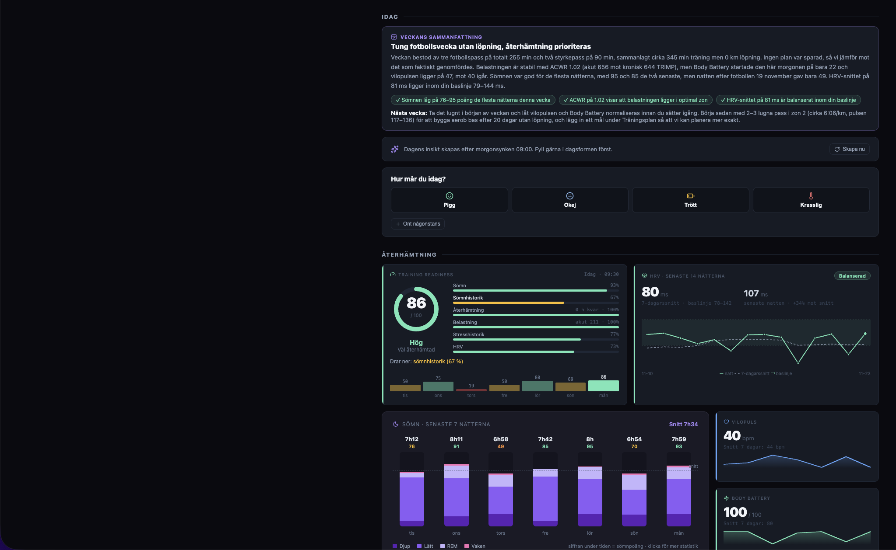
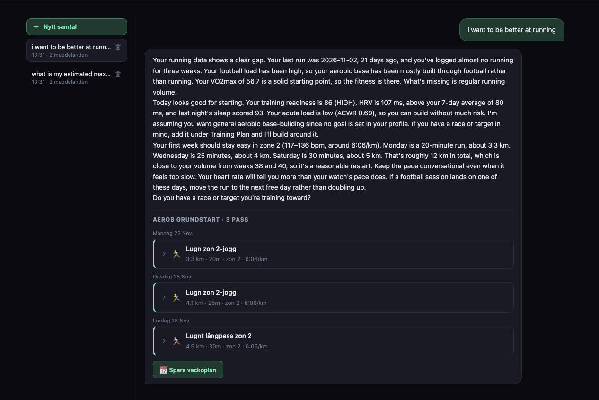
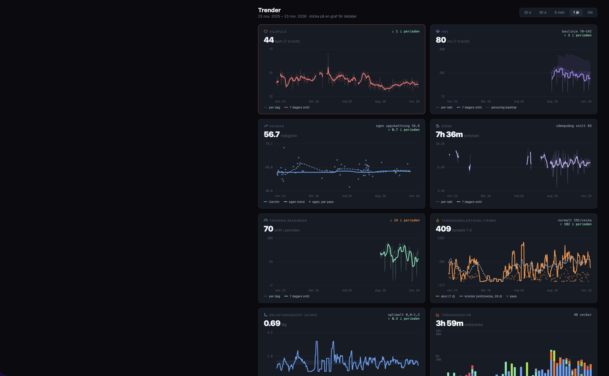
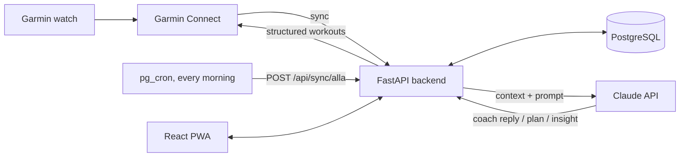

# Training Agent: an AI training coach built on your Garmin data

Training Agent is a full-stack web app that turns Garmin watch data into a personal AI coach. It syncs your training history, sleep, HRV and readiness every morning. It writes you a short daily briefing and lets you chat with a coach that knows your full history. It builds weekly training plans and sends the workouts straight to your Garmin watch.

The app is in use by a small group of friends. It is built and maintained by one developer.



## What it does

**🧠 An AI coach that knows your training**
- Chat with a Claude-powered coach. It gets a structured summary of your profile, personal records, heart-rate zones, weekly load, recent sessions, sleep, HRV and how you feel today.
- Conversations are saved and streamed. History is always rebuilt on the server, never trusted from the client.



**📅 Training plans that sync to your watch**
- The coach proposes dated sessions as a machine-readable block. That block is validated and saved as a weekly plan.
- Each planned session is automatically matched against what you actually did on Garmin, so it shows as done, missed, today or upcoming.
- One click sends structured workouts to the Garmin Connect calendar. These include intervals with heart-rate-zone or pace targets, and strength sessions as sets and reps. Moving or deleting a session cleans it up on the watch too.

**☀️ A daily coach**
- An automatic morning sync runs for every user, using `pg_cron` on Supabase. It is followed by a short AI-written morning insight with a recommendation for the day and an optional adjusted session.
- A weekly summary is generated every Sunday.

**💚 Day-form check-in and illness warning**
- A quick daily check-in records how you feel, symptoms and pain in a body part.
- An early illness warning fires when two of three signals deviate from your own 14-night baseline: skin temperature, HRV and resting heart rate.

**📊 Dashboard**
- Readiness, HRV, sleep, body metrics, trends and personal bests.
- An activity log grouped by day, with time in each heart-rate zone and intensity relative to your own history.
- Personal goals and an "about me" profile.
- Your own activity rules, for example "short runs at the football field are football".



**💬 Built-in user feedback**
- A small stick figure in the corner opens a speech-bubble feedback form. It captures context automatically: tab, device and screen width.
- 👍/👎 ratings on coach replies and morning insights.
- An admin inbox for triaging feedback and replying to users.

**📱 Mobile-first PWA**
- Responsive layout, bottom navigation and installable to the home screen.

## Tech stack

| Layer | Technology |
|---|---|
| Frontend | React 19, Vite, react-markdown, lucide-react, hosted on Netlify |
| Backend | Python, FastAPI, streaming responses, hosted on Render |
| Database | PostgreSQL (Supabase) in production, SQLite locally, with `pg_cron` for scheduled syncs |
| AI | Anthropic Claude API: Haiku for the coach and insights, Sonnet as the judge in evals |
| Data source | Garmin Connect via [`garminconnect`](https://github.com/cyberjunky/python-garminconnect) |
| Security | bcrypt passwords, JWT auth, Fernet-encrypted Garmin credentials |
| Ops | GitHub Actions for automated database backups |

## Architecture



1. **Sync.** `scripts/sync_garmin.py` fetches activities, daily health, sleep, VO2 max, race predictions and records into a generic schema. A first sync pulls about 5 years of history; later syncs pull the last 30 days.
2. **Context.** `scripts/context_builder.py` turns the database into a compact, sectioned context for the coach: profile, PRs, zones, weekly summaries, today's form, this week's plan, goals and the user's own notes.
3. **Coach.** `api/routes/chat.py` streams Claude's reply. Proposed plans come back as a hidden `[PLAN]{json}[/PLAN]` block, validated by the models in `scripts/plan.py`.
4. **Back to the watch.** `scripts/garmin_pass.py` converts a planned session into Garmin's workout format and schedules it.

## Engineering notes

- **Evaluated, not just prompted.** `scripts/coach_eval.py` runs 25 coaching scenarios against the coach, such as illness signals, plan adjustments, strength days and morning insights. A stronger model grades each answer, and plan output is checked against the real plan schema. `scripts/jamfor_modeller.py` compares quality and cost between models.
- **Multi-user from day one.** Every query is scoped to the authenticated user. A security test suite (`tests/test_sakerhet.py`) checks that no endpoint leaks or modifies another user's data.
- **Dual database mode.** The same code runs on SQLite locally and PostgreSQL in production. Schema changes live in `db/migrations/`.
- **Reverse-engineered workout format.** Garmin's workout IDs for sports, step types, end conditions and targets were verified against a real account (`scripts/probe_garmin_pass.py`), because the published constants are partly wrong.
- **Status is computed, never stored.** Whether a planned session was completed is derived on every read by matching it to actual activities, so it can never drift out of sync.

## Running locally

**Requirements:** Python 3.11+, Node 20+, an Anthropic API key and a Garmin Connect account.

```bash
# Backend
python -m venv .venv && source .venv/bin/activate
pip install -r requirements.txt
cp .env.example .env   # or create .env with the variables below
uvicorn api.main:app --reload            # http://localhost:8000

# Frontend
cd frontend && npm install && npm run dev  # http://localhost:5173
```

**Environment variables**

| Variable | Purpose |
|---|---|
| `ANTHROPIC_API_KEY` | Claude API key |
| `JWT_SECRET` | Secret for signing login tokens (long random string) |
| `ENCRYPTION_KEY` | Fernet key for encrypting stored Garmin credentials |
| `DATABASE_URL` | PostgreSQL URL. Omit it to use SQLite at `data/training.db` |
| `COACH_MODELL` | Optional. Overrides the Claude model used by the coach |

Generate an encryption key with:

```bash
python -c "from cryptography.fernet import Fernet; print(Fernet.generate_key().decode())"
```

**Tests**

```bash
pip install -r requirements-dev.txt
pytest
```

## Project structure

```
api/            FastAPI app, auth, routes (chat, plans, sync, insights, feedback, …)
coach/          System prompt and CLI coach
scripts/        Garmin sync, context builder, plan model, Garmin workout export, evals
db/migrations/  SQL schema migrations
frontend/       React + Vite PWA
tests/          Security and privacy tests
```

## Roadmap

- Choose your device: support for more wearables beyond Garmin, such as Polar, WHOOP and Oura.
- A strength log with a muscle map.
- A Fitness & Freshness form curve (training load over time).

## Disclaimer

This is a personal project and is not affiliated with Garmin or Anthropic. The coach gives general training guidance, not medical advice.
